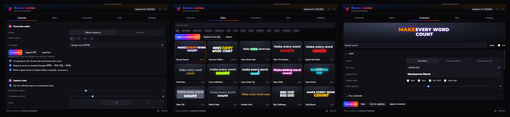
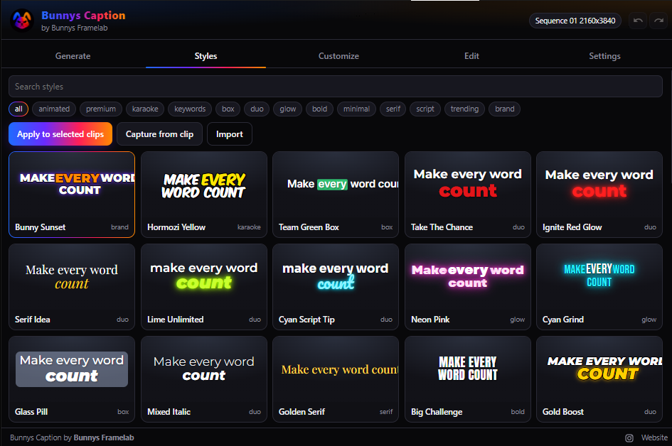
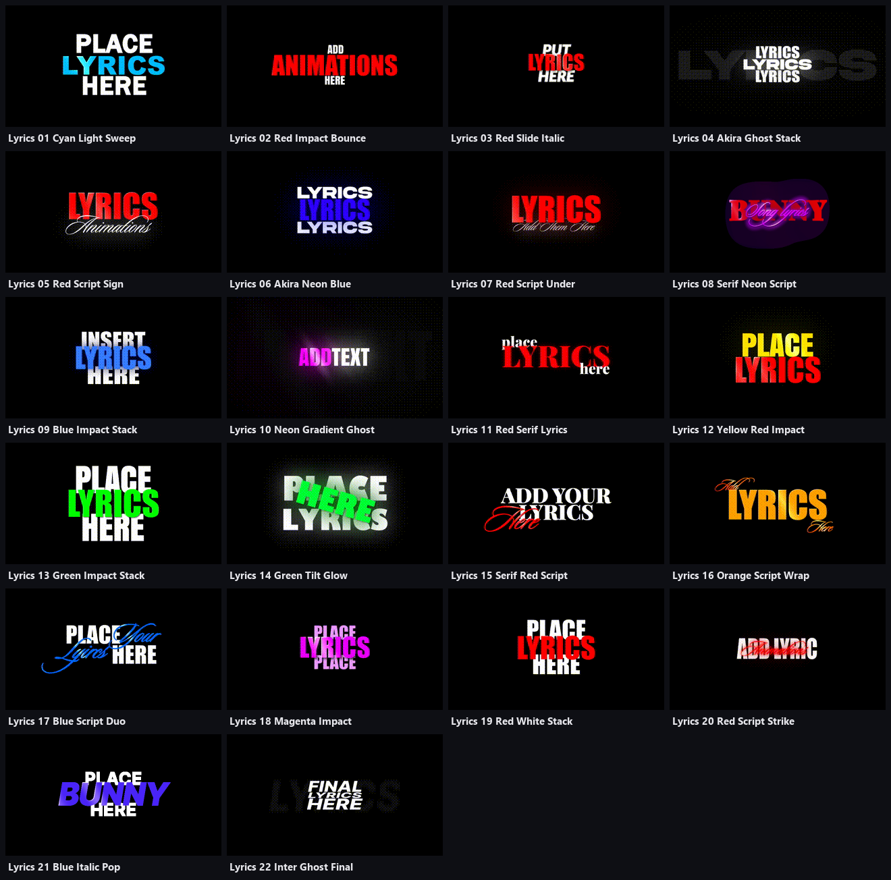

# Bunnys Caption

**Auto captions for Adobe Premiere Pro and After Effects.** Bunnys Caption listens to your video, writes the captions and places them on your timeline, each caption as its own editable, styled and animated clip. Everything runs on your own PC: no internet needed after setup, no account, no upload.

Made by **Bunnys Framelab** · [Instagram @bunnysframelab](https://www.instagram.com/bunnysframelab) · [Website](https://framelabmedia.odoo.com)

## Features

| | |
|---|---|
| **Auto captions** | English, Bangla, Banglish, Hindi and Hinglish |
| **Translate** | English captions from Bangla, Hindi or any language, offline on your PC |
| **Word highlight** | Active word, keywords, karaoke fill |
| **77 built-in styles** | Ready looks, including 22 animated **Lyrics** styles, plus your own saved styles |
| **Full control** | Font, bold, italic, caps, colours, 5-colour gradient, glow, box, animation |
| **PRO looks** | 3D depth, bevel, inner glow and shadow, light sweep, deep glow |
| **Your MOGRTs** | Use any `.mogrt` template as a caption style |
| **Capture** | Tweak a caption on the timeline, save it as a style |
| **Undo / Redo** | Every change, with Ctrl+Z and Ctrl+Y |
| **Two apps, one panel** | Works in Premiere Pro and After Effects (AE gets native, editable layers) |

### Lyrics styles

22 native After Effects lyric animations, each one a MOGRT with its own controls: **Line 1-3** text, **Speed** (50 = original), **Custom Colors** with a colour per line, **Glow**, **Light Sweep**, **Shadow** and **Opacity**. The caption words are split across the lines by themselves. Select Lyrics clips on the timeline and change them live from the **Edit** tab.

## Requirements

- Windows 10/11 or macOS 12+
- Adobe Premiere Pro or After Effects **2023 or newer** (CEP 11-13)
- About 70 MB to 3.5 GB of disk space for the speech models, depending on your languages
- Optional: an NVIDIA GPU (3 to 10 times faster). Macs with Apple Silicon use the Apple GPU by themselves.

## Install

1. **Download** this repository: green **Code** button → **Download ZIP**, then extract it to a folder you keep (for example `E:\Bunnys Caption`). Do not use Downloads or Desktop if you clean them often.
2. **Close** Premiere Pro and After Effects.
3. Open the `Plugin` folder and run the installer:
   - **Windows:** double-click `Install on Windows.bat` (if Windows warns you: *More info* → *Run anyway*).
   - **Mac:** double-click `Install on Mac.command` (if macOS blocks it: right-click → *Open* → *Open*). Answer **Y** to install the speech engine with Homebrew.

   The installer copies the panel to your user CEP extensions folder, turns on Adobe's `PlayerDebugMode` (needed for panels not signed by Adobe, only for your user account) and installs the fonts from the `Fonts` folder for your user.
4. Open Premiere Pro or After Effects → **Window → Extensions → Bunnys Caption**. In After Effects, open the composition you want to caption first.

Full step-by-step guide with manual install and troubleshooting: open [`INSTALLATION.html`](INSTALLATION.html) in your browser.

### Speech engine and models

The engine and the models are not in this repository (they are large). The panel gets them for you:

- **Settings → Engine / Model → Download** downloads the speech engine ([whisper.cpp](https://github.com/ggml-org/whisper.cpp) v1.9.2) and the model you pick from their official pages, once.
- Or download the files yourself and use **Settings → Offline files → Choose folder → Install all from folder**:

| File | What it is | Source |
|---|---|---|
| `whisper-bin-x64.zip` | Speech engine, CPU (any PC) | [whisper.cpp v1.9.2 release](https://github.com/ggml-org/whisper.cpp/releases/tag/v1.9.2) |
| `whisper-cublas-12.4.0-bin-x64.zip` | Speech engine, NVIDIA RTX 20-50 | same release |
| `whisper-cublas-11.8.0-bin-x64.zip` | Speech engine, NVIDIA GTX 10/16 | same release |
| `ggml-silero-v5.1.2.bin` | Voice detector, always needed | [ggml-org/whisper-vad](https://huggingface.co/ggml-org/whisper-vad) |
| `ggml-base.en-q5_1.bin` (and other `ggml-*.bin`) | Speech models | [ggerganov/whisper.cpp](https://huggingface.co/ggerganov/whisper.cpp) |
| `llama-b11803-bin-win-*.zip` | Translator engine (only for English captions from Bangla/Hindi) | [llama.cpp b11803 release](https://github.com/ggml-org/llama.cpp/releases/tag/b11803) |
| `Qwen3-4B-Q4_K_M.gguf` | Translator model | [Qwen/Qwen3-4B-GGUF](https://huggingface.co/Qwen/Qwen3-4B-GGUF) |

On Mac the engines come from Homebrew (`brew install whisper-cpp`, and `brew install llama.cpp` for translation).

**Bangla Pro** (`ggml-bangla-medium-q5_0.bin`) is Whisper medium fine-tuned on Bangla speech ([OmiKhan/bangla-asr-whisper-medium](https://huggingface.co/OmiKhan/bangla-asr-whisper-medium), Apache-2.0) converted for whisper.cpp. It is in the full Bunnys Caption offline package; you can also convert it yourself with whisper.cpp's `convert-h5-to-ggml.py` and quantize it to `q5_0`.

### Which model to pick

| Your video | Generate → Language | Settings → Model |
|---|---|---|
| English | English | Base English (60 MB) |
| Bangla, Bangla text | Bangla speech → Bangla script | Bangla Pro |
| Bangla, Banglish text | Bangla speech → Banglish | Bangla Pro |
| Bangla, English text | Bangla speech → English translation | Bangla Pro + Translator |
| Hindi or Hinglish | Hindi speech → Hindi script / Hinglish | Large v3 Turbo |
| Hindi, English text | Hindi speech → English translation | Large v3 Turbo + Translator |
| Any other language | Any other language → English translation | Large v3 Turbo |

## How to use it

| Tab | What you do there |
|---|---|
| **Generate** | Pick the language → **Transcribe** → check the text → **Add captions**. |
| **Styles** | Click a style to use it. **Apply to selected clips** restyles captions you selected. **Import** adds a `.json` style or your own `.mogrt`. **Capture from clip** saves a caption's look as a new style. |
| **Customize** | Change everything about a style. **Save as new**, **Reset**, and **Live** sends every change straight to the selected captions. |
| **Edit** | Quick font, colour and animation changes on selected captions, text and timing editing, and the Lyrics clip controls. |
| **Settings** | Engine, model, CPU or GPU, the offline files folder and a self-test. |

### How it works

1. The panel exports the sequence (or comp) audio.
2. The voice detector cuts the audio at pauses.
3. The speech engine (whisper.cpp) and your model write the text, with the time of every word.
4. For Bangla and Hindi, a word list fixes common spelling mistakes.
5. The text is split into short captions using the style's rules.
6. Each caption lands on the timeline as a Bunnys Caption graphic with the style applied. In After Effects the panel unpacks the template's AE project and adds native layers with the same controls.

### CPU or GPU

| Your PC | Use | Speed |
|---|---|---|
| Any PC | CPU engine | A 1-minute video in about 10-60 s |
| NVIDIA RTX 20 / 30 / 40 / 50 | GPU engine, CUDA 12 | 3 to 10 times faster |
| NVIDIA GTX 10 / 16 | GPU engine, CUDA 11 | 3 to 5 times faster |
| Mac with Apple Silicon | Homebrew engine (Metal) | Fast |

## Repository layout

| Folder | What it is |
|---|---|
| `Plugin/` | The CEP panel for Premiere Pro and After Effects, with the installers |
| `Plugin/jsx/host.jsx`, `host_ae.jsx` | Host scripts for Premiere Pro and After Effects (same API) |
| `Plugin/js/` | Panel code: speech engine, captions, styles, translator, previews |
| `Plugin/mogrt/` | Caption templates: `Bunnys Caption`, `Bunnys Caption Pro` and `Lyrics/` (22 lyric templates) |
| `Plugin/dict/` | Bangla and Hindi word lists for spelling fixes |
| `Fonts/` | Fonts the Lyrics styles use (installed by the installer) |
| `Source/` | For developers: After Effects scripts that build the caption and Lyrics templates |
| `docs/` | Screenshots for this page |

## Troubleshooting

| Problem | Fix |
|---|---|
| Not in Window → Extensions | Run the installer again, then quit the app completely and reopen it. |
| The panel opens blank | Close the app, run the installer again. |
| "Engine not installed" or no models | Settings → download the engine and a model, or point *Offline files* to the folder with the files. |
| "No empty video track" | Sequence → Add Tracks → add 1 video track. |
| Wrong or missing font | Install the font, or pick another one in the Customize tab. |
| Anything else | Settings → **Run self-test**. The report is saved to `%APPDATA%\BunnysFramelab\BunnysCaption\selftest.log`. |

**Uninstall:** close the app and run `Uninstall on Windows.bat` or `Uninstall on Mac.command` in the `Plugin` folder. Saved styles stay in `%APPDATA%\BunnysFramelab` (Windows) or `~/Library/Application Support/BunnysFramelab` (Mac).

## Changelog

### 1.2.0
- The 22 lyric styles are now part of Bunnys Caption as **Lyrics 01-22** (templates in `Plugin/mogrt/Lyrics`), rebuilt with the same look and controls.
- Styles and settings saved with 1.1 move to the new names by themselves; lyric clips already in your projects keep working.
- After Effects: fixed "Template comp not found" when two different templates are used in the same project.

## Credits

Uses [whisper.cpp](https://github.com/ggml-org/whisper.cpp) (MIT), [llama.cpp](https://github.com/ggml-org/llama.cpp) (MIT), [OpenAI Whisper](https://github.com/openai/whisper) models (MIT), [Silero VAD](https://github.com/snakers4/silero-vad) (MIT) and [Qwen3-4B](https://huggingface.co/Qwen/Qwen3-4B) (Apache-2.0). Fonts in `Fonts/` belong to their designers and foundries.

Premiere Pro and After Effects are trademarks of Adobe. Bunnys Caption is not made by Adobe.

© Bunnys Framelab. All rights reserved.
